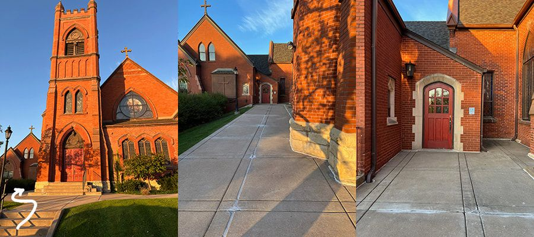

Email us at [{{ site.email }}](mailto:{{ site.email }}).

Or write to us by mail:

<address>
  {{ line }} 
  
</address>

## Directions

We meet at:

<address>
  <a href="{{ site.meeting_place.map_url }}">{{ site.meeting_place.name }}</a> 
  {{ site.meeting_place.street }} 
  {{ site.meeting_place.city }}
</address>

<iframe class="map" title="Map showing {{ site.meeting_place.name }}, {{ site.meeting_place.street }}"
        src="https://www.google.com/maps?q=Ascension+Episcopal+Church,+214+3rd+St+N,+Stillwater,+MN+55082&amp;output=embed"
        loading="lazy" referrerpolicy="no-referrer-when-downgrade"></iframe>

## Parking

- Ample parking is usually available on both sides of 3rd Street.
- There is a free parking lot two blocks away on 4th Street, by the Post Office.
- In winter, on-street parking follows the odd/even date rules.

## Finding the door

Go up the steps and around to the left, past the two main doors. Enter at **door C**.

