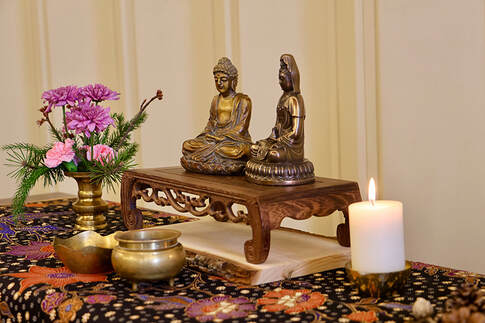

## Our mission

Our mission is to be a welcoming place for people interested in joining a supportive meditation community, to engage in and teach the practice of meditation and Zen Buddhism, and to reach out to the surrounding community through classes and retreats.

As part of living out our intentions, we are exploring a path between traditional and contemporary ways of practicing, and are wholeheartedly engaged in contributing to the ongoing growth and development of Zen Buddhism in the West.

While our practices are rooted in the Soto Zen Buddhist tradition, rich with Japanese forms and aesthetics, we welcome people from all traditions and faiths, including those who are agnostic, non-religious, and simply curious.

We are a 501(c)(3) nonprofit that is currently entirely volunteer-run; this provides us with many opportunities for wholehearted practice.

## Our values

- Understanding our interconnectedness with all beings and cultivating harmony in the community: welcoming everyone, excluding no one.
- Looking deeply and awakening to the true nature of reality.
- Walking fully and completely with all beings and things, the great earth, and the vast universe.
- Being and growing benevolence, compassion, equanimity, and sympathetic joy in everything we do.
- Sharing the great wish that all beings be free from suffering and the root of suffering.

