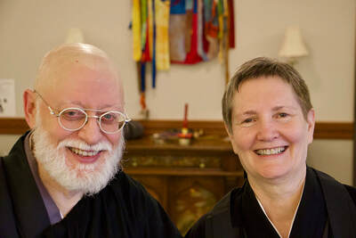

## Laura Kattō Phillips

**Guiding Teacher**

Kattō started practicing Zen at Clouds in Water Zen Center in 1997. After moving to Stillwater and practicing with Zen Bridge for a few years, she re-engaged with Clouds in Water and received the Buddhist precepts from Byakurin Judith Ragir in 2014. In 2022 she was ordained as a Soto Zen priest by Sosan Theresa Flynn. Then in 2023, she entered the role of sensei at Zen Bridge after having been a member for 17 years. She received Dharma Transmission, full teaching authority, from Sosan in 2026 and is now serving as the guiding teacher for Zen Bridge.

As a Zen teacher and retired psychotherapist with 20 years of trauma-related work, she explores ways for people to build nurturing, respectful ways of connecting with authenticity, compassion and curiosity, within the Zen community and beyond. She and her husband, Jeff, enjoy hiking, cooking, studying and spending time with family, friends, and sangha.

## Christopher Shoshin Hafner

**Assistant Guiding Teacher**

Shoshin first encountered the Buddha’s teaching at a very young age and has been a Buddhist most of his life. He is a long-time student of Tim Burkett, who was a student of Shunryu Suzuki and the former guiding teacher of the Minnesota Zen Meditation Center (MZMC). Shoshin began studying with Tim in 2005. He received Jukai from Tim in 2007, was ordained by him in 2009, received lay transmission (permission to teach independently) by him in 2024, and full Dharma Transmission by Tim in 2025.

Shoshin is a doctor and professor of Traditional Chinese Medicine and a retired faculty member of the Center for Spirituality and Healing at the University of Minnesota, where he taught for many years. He currently lives in Stillwater with his wife Nancy and two cats, and enjoys gardening, cooking, botanical art, studying Japanese, and learning to play the shakuhachi.
